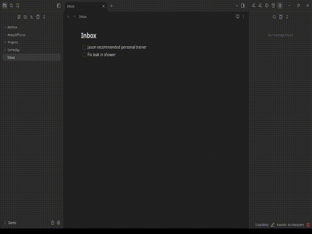

# GTD Clarify

An Obsidian plugin that walks you through your task list one item at a time, asking the
questions a GTD review asks, and doing the filing for you.

It works on top of the [Tasks](https://github.com/obsidian-tasks-group/obsidian-tasks)
plugin, which it uses for editing individual task lines.



In the demo, **Process** works through an inbox note holding two captured items:

1. *Jason recommended personal trainer* is actionable and only one step, so it is rewritten
   as a clear next action, *Message Jason asking for details of his personal trainer*. It
   is then labelled with its context, energy and duration, and moved to the triathlon
   project it serves.
2. *Fix leak in shower* needs more than one step, so it becomes a project with its first
   two next actions. The second is set to wait until the first is done, and the first is
   then labelled in turn.

> **Status:** new. It has been used daily on a real vault, but by one person. Try it on a
> vault you have backed up.

## What it does

Three commands, from the command palette or the ribbon menu:

**Sweep** — for getting things out of your head. It prompts you, one at a time, with
what's on your mind, then each of your areas of focus, projects and contexts, then a list of
common triggers, and puts each thing you type into your inbox note as a task. Then it
offers to process them.

**Process** — for a raw inbox. For each top-level task it asks whether the item is
actionable this week, and if not routes it to reference, someday, another note, or the
bin. If it is actionable, it asks whether it is a project, and helps you break it into
subtasks — or, if someone else is doing it, makes it a waiting-for.

**Organise** — for tasks you have already triaged. It walks each task through your
configured dimensions (context, energy, duration, priority, and any custom ones you add),
writing the answers back to the task line, then files the task where you tell it to.
Labels a task already has are not asked for again.

Process and Organise run from any note containing tasks, and ask first whether to work
through **this note** or **a Tasks query** — so either can operate on one file or across
the whole vault. If you'd rather do both in one pass, switch on *Organise as you process*:
each task is then organised as soon as Process has decided it.

Each run ends with a short summary of what became of the tasks — six next actions, two
waiting on someone else, three to Someday, and so on.

Everything happens in a sidebar pane rather than a modal, so the note stays visible while
you work.

## Sweep: emptying your head

GTD starts with getting everything that has your attention out of your head, before
deciding anything about it. **Sweep** prompts you through it:

1. **What's on your mind?** — anything at all.
2. **Each area of focus** — every note in your areas folder: *Anything about Health?*
3. **Each project** — every open project in your project folder.
4. **Each context** — the answers of your context step: *Anything about Phone?*
5. **A trigger list** — commitments, communication, home, money, people and so on, each
   with a few reminders. Edit it in settings to suit your life. A trigger named like one of
   your areas or contexts — Health, Home — adds its reminders to that prompt instead of
   being asked twice.

Type a thought and press Enter; type the next. Each one goes into your inbox note as a task
the moment you add it, so stopping part-way loses nothing — and **×** takes one back. Enter
on an empty line, or **Next**, moves on; **Skip the rest of…** passes over the rest of your
projects (or areas, contexts or triggers); **Finish** ends the sweep. Pasting several lines
adds them as one thought, joined by spaces — a pasted paragraph is one thing on your mind,
not one per line.

At the end it tells you how many it captured and offers to **Process** the inbox straight
away. It needs no note open: set the inbox note and areas folder under *Sweep* in settings.

## Answering quickly

- **The key word is bold.** In every question and answer, the word that tells it apart is
  in bold — **Actionable** this week?, Mark as **cancelled**, File as **reference** — so a
  glance down the bold words is enough to choose.
- **Number keys pick answers.** On a keyboard, press 1–9 for the answer with that number
  (shown on each button) and 0 to skip an optional step. Ignored while you're typing in a
  note or a field, and not used on a phone. Switch it off under *Number keys pick answers*.
- **Answers keep their places.** They are ordered by how often they are chosen, and the same
  answer sits in the same place on every item: Yes and No first on *Actionable this week?*,
  *Rewrite it…* first on *Is this a clear next action?*, *Search for a note…* first on *Move
  to…* after any quick destinations of your own. Lists that are a scale — dates, priority —
  keep their natural order.
- **Where you filed last is one tap.** *Move to…* lists the last three notes you moved a
  task to under *Recent*, after the usual answers, so a run of tasks for the same area or
  project doesn't mean searching for it each time.
- **The likely context is marked.** A next action's opening verb usually says where it is
  done — *Call* at a phone, *Buy* when you're out, *Ask* on someone's agenda — so the context
  it points to is marked *suggested*. Nothing is chosen for you and nothing moves; it is
  matched against the names of your own contexts, so it only suggests one you have.
- **What a task already has isn't asked again.** A task captured as "Call Sam #phone", or
  organised once before, skips the context question; one with a priority skips priority.
  Plain-word labels (an energy of *hi*, a duration of *long*) count only at the end of the
  task, so "Write a long letter" is still asked its duration.
- **Skip step is out of the way.** On optional steps it sits on its own row at the right,
  the same place every time, well away from *Skip task* in the bar at the bottom.
- **Wording is clarified only where you'll meet it again.** For something not actionable,
  marking it cancelled or completed, or deleting it, asks for no rewording. Deferring it,
  putting it in Someday, filing it as reference or moving it does — once.

## GTD coaching

The plugin prompts for the parts of GTD that make outcomes and next actions effective. The
method's own literature is consistent that captured wording is usually the first thing that
came to mind rather than the next physical step, and that clarifying it is the step people
most often skip — so the plugin asks rather than assuming.

- **Outcomes and next actions are distinguished.** "Does this need more than one step?"
  separates a single action, a project's outcome, and a step in a bigger project.
- **Filed actions are checked.** Filing a capture under a project asks whether it is a clear
  next action, one tap to skip.
- **Vague wording is caught.** "Sort out the website", "Plan the offsite", "Follow up with
  Sam" or "Taxes" get an offer to rewrite, with the reason shown; well-formed actions pass
  silently. Filler such as "Need to…" or "TODO:" is skipped first, so it can't hide a vague
  verb. Both the phrase list and the filler list are editable under Settings -> GTD
  coaching; extra phrases that are only sometimes vague ("fix", "prepare") are listed there
  switched off.
- **Every project needs a next action.** Organise flags a project with nothing you can do.

Both prompts can be switched off under Settings -> GTD coaching.

Each step of Process and Organise also carries a short tip explaining it in GTD terms — why
"actionable this week" keeps your lists trustworthy, why priority is the last of GTD's four
criteria rather than the first, why a project needs only the next actions you can start now.
They sit behind a ⓘ on each question; tap it when you want a reminder. They can also be
shown in full, or hidden entirely.

## The two-minute rule, as a batch

GTD says to do anything under two minutes rather than track it. Doing it mid-processing is
where sessions get derailed — the quick reply turns into a long one, and the list never gets
emptied. So when Process asks *"Actionable this week?"*, answer *"Yes — under two minutes,
batch it"*: the task is decided now and done in a batch at the end, once everything else is
decided. If one is still going at five minutes, choose *Took longer* and
it stays on your list.

## Splitting a compound capture

A capture holding several things — "call Sam, buy milk, book the venue" — has no single
answer to "is it actionable?". Choose *"It's several things — split it…"* and enter each
item; every one is then clarified on its own. If they're all steps towards one outcome,
that's a project instead: answer *"this is the project's outcome"*.

## Someone else does it: waiting-for

When the answer to *Actionable this week?* is that someone else will do it, choose **Yes —
someone else does it…**. Reword the task as what you're waiting for and who from — *Sam:
quote for the boiler* — and it is tagged `#waitingfor`. Then pick when you'd chase it if
nothing has come: the date goes on as its start date, as *Not yet* does, so it stays out of
Process until then, and a Tasks query can list just the ones due a chase:

```
not done
tags include #waitingfor
starts before tomorrow
```

A project's next action can be someone else's too: it waits inside the project. Organise
files a waiting-for without asking for context, energy or time — those are about doing a
task, and this one isn't yours to do. The tag is set under *Waiting-for tag*.

## One step in a bigger project

*Does this need more than one step?* → *Yes — it's one step in a bigger project…* asks
**Which project**. Projects in the note you're working through are listed by name under
*In this note*; projects anywhere else are found with **Search projects…**, under *In other
notes*, each shown with the note it's in. A step filed under a project in another note is
labelled there and then — Organise on this note won't see it again — and leaves this
review, as a task sent to Someday does.

## A project's last next action

A project is only active while it has something to do, so the plugin never leaves one empty
without asking:

- **Someday for a project's last open task** asks first: send the **whole project** to
  Someday — with the task still inside it, as it was — or just this step, and then add the
  project's next action or leave it for now.
- **Any other way the last one goes** — done, cancelled, deleted, moved to another note,
  filed under another project, done in the two-minute batch — asks what becomes of the
  project: add a next action, send it to Someday, mark it finished, cancel it, or leave it.
  The likely answer is marked *suggested*.
- A deferred step or a waiting-for still counts: the project is deferred or waiting, not
  empty.

It works the same whether the task came from a note or from a Tasks query, so there is no
need to add the project tag to your queries. In Organise, a step a query finds inside a
project is labelled where it is and stays in its project; the project itself is filed, whole,
when Organise reaches it.

## Cancelling and fixing mistakes

Cancelling a picker or a Tasks dialogue takes you back to the question that opened it, never
on to the next task — use *Skip task* for that. While adding a project's next actions,
*Fix one of these…* lets you reword or remove any you've made in that go without starting
again; removing one that others wait on keeps the waiting order intact.

## Filing within a note

When Organise is working through *This note*, *Move to…* also offers *A heading in this
note…*, so a note can be sorted into its own sections. The task goes to the end of the
heading's own content, before any subheading, with its subtasks.

## Re-processing while you organise

Work moves on between processing a task and organising it. In Organise, **Re-process** (in
the bar at the bottom) undoes what organising has done to the task in front of you, then
lets you **fix its wording** or **process it again from the start** — make it a project,
split it, defer it, delete it — after which Organise carries on with whatever it has
become. While a project's next actions are being labelled, it applies to the one on screen —
or choose **Process the whole project again** to start where Process does, with whether the
project is actionable this week, so you can defer, park or cancel it with all its next actions.

## Deferring work: the tickler

When something isn't actionable this week, Process separates two different answers:

- **Not yet — bring it back on a date…** for things you will do but can't start yet. It sets
  the Tasks start date (🛫) and asks where the task should wait — leave it in place, or file
  it now so it comes back to the right list. It stays out of Process until that date. Organise
  still includes it, since deferred work still needs a home.
- **Someday — not committed** for things you might never do. These go to your Someday note
  and wait for you to look.

**Another date…** takes the date the way you'd say it — *next Wednesday*, *Fri*, *3 Nov*,
*in 10 days*, *end of month* — or from a calendar, and shows the date it has read before you
use it. *Wednesday* is the next Wednesday; *next Wednesday* is the Wednesday of next week
(weeks start on Monday), so said on a Tuesday it is eight days away. The preview settles it.

Only defer to a date if there's a real reason it can't happen sooner. A made-up date just
comes back and gets pushed again.

**For your own action lists to hide deferred tasks too**, add one line to their `tasks`
blocks:

```
starts before tomorrow
```

Tasks treats a task with no start date as already started, so this keeps everything undated
and hides only what you have deferred.

## Features

### Undo that actually undoes

Changed your mind three prompts in? Every task records the prior contents of each file it
touches, so:

- **Restart task** puts those files back and runs the task again from its first question.
  This is the one you will reach for most — it undoes a wrong answer in the task you are
  looking at.
- **Revert last** does the same and also undoes the previous task, reopening it. Rarer and
  wider-reaching, so it sits second and is styled more quietly.

Notes created during an undone task are moved to trash, not deleted, so an undo that was
itself a mistake is still recoverable.

Cancelling the Tasks add/edit dialogue redoes the smallest unit of work it can, rolling
back anything the abandoned attempt had written: one subtask if you are inside a project's
subtask walk, otherwise the whole task. **Restart task** always restarts the whole task.

Restart is also the answer to cancelling out of the Tasks edit modal on older versions. That modal gives no
signal about whether you saved or escaped, so the plugin cannot detect it — but you can
press **Restart task** and the escape costs you nothing.

### Query-driven reviews across the vault

Instead of processing one note, you can review everything matching a query — saved in
settings or typed at the prompt:

```
not done
is not blocked
tags include home
```

Undo, Restart and Revert all work exactly as they do for a single file, including across
file boundaries. When a query surfaces a subtask, its ancestor chain is shown above it as
dimmed context, so you can see which project it belongs to before deciding.

> **Important:** these filters are *this plugin's own re-implementation of a subset* of the
> Tasks query language, not the language itself. The Tasks API cannot run searches — its
> documentation lists this under "Limitations of the Tasks API" (issue #2459), and issue
> #3142 requests the Query class be exposed. What the plugin uses is `getTasks()`, a
> public but undocumented method that returns Tasks' parsed task list; the filtering is
> ours. Supported filters are listed in the settings tab, and **an unrecognised filter is
> reported as an error rather than ignored** — a silently dropped filter would widen your
> result set without saying so.

Supported filters: `done`/`not done`, `is blocked`/`is not blocked`, `tags include`,
`path`/`description`/`heading includes`, `has`/`no due|start|scheduled date`,
`due|starts|scheduled before|after|on`, `priority is [above|below]`, `exclude subitems`,
`limit`.

Filters combine on one line exactly as they do in Tasks:

```
not done
(tags include home) OR (tags include phone) OR (tags include pc)
NOT ( (path includes archive) OR (tags include someday) )
```

`AND`, `OR`, `NOT`, `AND NOT`, `OR NOT` and `XOR`, with precedence `NOT > XOR > AND > OR`,
nesting, and five delimiter pairs — `(…)`, `[…]`, `{…}`, `"…"`, `“…”` — one type per line.
Operators must be capitalised, so an ordinary "or" in a description is never mistaken for
one. Trailing backslashes continue a line. Separate lines still combine with `AND`.

### Note picking that ranks like the quick switcher

The note and folder pickers rank by *where* the match lands, not by a single fuzzy score
over the whole path:

| Band | Tiers |
| --- | --- |
| Filename | exact → prefix → substring |
| Alias | exact → prefix → substring |
| Fuzzy filename | matches falling inside the basename |
| Path | alias fuzzy → folder substring → path fuzzy |

Ties break on fuzzy score, then recently-opened, then path depth. Typing `Relationships`
surfaces `Areas/Relationships` above `Relationships - a long project title`, which a plain
fuzzy match does not.

### Respects Excluded files

Paths listed in **Settings → Files and links → Excluded files** sort below every other
result and render dimmed. They are never hidden — narrowing the query still reaches them.

### Compact links

A raw URL in a task line is often longer than the task. They render as host plus a short
path (`theguardian.com/technology/20…`), and Markdown links render as their link text. The
full URL is still there on hover, the link opens in your browser when clicked, and the
underlying file is never modified. Internal links — `[[Note]]`, `[[Note#Heading]]`,
`[label](Note.md)` — are clickable too, and open in a new tab so the note under review
stays put. When a task was found by a Tasks query, the note path shown above it links to
the task in its note.

## Installing

In Obsidian, open **Settings → Community plugins → Browse**, search for **GTD Clarify**, then
install and enable it.

To install by hand instead:

1. Download `main.js`, `manifest.json` and `styles.css` from the
   [latest release](../../releases/latest).
2. Put them in `<your vault>/.obsidian/plugins/gtd-clarify/`.
3. Reload Obsidian and enable **GTD Clarify** in **Settings → Community plugins**.

Requires the **Tasks** plugin. Templater is optional — if it is installed, templates can
use Templater syntax; otherwise the core Templates plugin is used.

## Privacy

GTD Clarify makes no network requests and collects nothing. It reads and changes only notes in
your vault — the ones a review works through and the ones you file tasks into — and keeps
its settings in its own `data.json`. Links in a task open only when you click them.

## Settings

| Setting | What it does |
| --- | --- |
| Someday note | Where "not this week" tasks are appended. |
| Reference folder | Where reference notes are created. |
| Project folder | Where new project notes are created. |
| New note folder | Default parent for "Create a new note…". |
| Curated move targets | Paths that appear at the top of the "Move to…" list. |
| Project tag | The tag that marks a task as a project (default `project`). |
| Waiting-for tag | The tag *Someone else does it* adds (default `waitingfor`). |
| Organise as you process | Ask Organise's questions about each task straight after Process decides it. A task in the two-minute batch is organised after the batch, if it's still open. Off by default. |
| Inbox note | Where Sweep puts what you capture (default `Inbox.md`). Created if missing. |
| Areas of focus folder | Sweep asks about each note in this folder. Empty leaves areas out. |
| Ask about each project / context | Whether Sweep prompts with each open project in the project folder, and each context. |
| Trigger list | Sweep's last prompts. A line ending in a colon is one prompt; the lines under it are its reminders. |
| Task placeholder | Marker in a template where moved tasks are inserted. |
| Dimensions | The questions Organise asks. Fully editable — add your own. Each has a **Heading** (shown in Organise; put `**double asterisks**` round the word to bold) and a short **Label**. |
| Number keys pick answers | Press 1–9 to answer and 0 to skip a step, with the numbers shown on the buttons. On by default; never on a phone. |
| Priority step | Offer a priority question during Organise. |
| Custom tag step | Offer the free-text tag prompt at the end of Organise. |
| Mark as completed | Offer marking a task and its subtasks done, in place, through Tasks — with the done date (✅) if Tasks is set to add one. |
| Mark as cancelled | Offer marking a task and its open subtasks `[-]`, in place — with the cancelled date (❌) if Tasks is set to add one. |
| Delete | Offer removing a task and its subtasks entirely. |
| Confirm before removing | Ask before deleting or marking a task and its subtasks. |
| Highlight source line | Highlight the task under review in the open note. |

## Example configuration

[`examples/data.json`](examples/data.json) is one real setup, included as a starting point:

- four dimensions — **context** (Home, Outings, Phone, Agenda), **mental processing mode**
  (Creative, Critical, Intake, Admin, Social, Strategy), and **energy** and **duration**
  written as plain words rather than tags;
- three saved queries — an overview across areas, a home list, and a work list — for a vault
  with `Work/`, `Someday/`, `Archive/` and `Inbox` folders. Change the paths and tags to match
  yours;
- Sweep writing to a `- Inbox -` note at the vault root, with areas of focus as notes in an
  `AreasOfFocus` folder and projects in `Projects`.

To use it, quit Obsidian, copy it to `<your vault>/.obsidian/plugins/gtd-clarify/data.json`, and
reopen. That replaces your current GTD Clarify settings, so copy any you want to keep first —
or open it and copy just the queries or dimensions across in the plugin's settings.

## Development

The source is `src/main.js`. `npm run build` bundles it into `main.js`, the file Obsidian
loads; `main.js` is not committed, and is attached to each release instead.

```bash
npm install     # once: the build and lint tools
npm run build   # src/main.js → main.js
npm run lint    # the rules Obsidian's automated review applies, and a type check
npm test        # build, then run the test suite
npm run check   # lint + tests, as CI runs them
```

To try a change in a vault, build and copy `main.js`, `manifest.json` and `styles.css` into
that vault's `.obsidian/plugins/gtd-clarify/`, then reload the plugin.

The source is JavaScript typed with JSDoc comments (`/** @param {obsidian.TFile} file */`).
The types change nothing at runtime; they let `tsc` and the review's type-aware lint rules
check the code, and `npm run lint` runs both. The shared shapes — settings, a review item,
the context every step is handed — are defined once, near the top of `src/main.js`.

The tests run on Node's built-in test runner. They load the built `main.js` with a stub
`obsidian` module (`tests/helpers/`), so they exercise the code that ships rather than a
copy, and reach internals through the `__testables` export at the bottom of
`src/main.js`. Some tests read `src/main.js` itself, to check its structure.

`tests/regressions.test.js` is worth reading before making changes: each test names a
defect that actually shipped, including several that are structural (a deleted CSS rule,
an inherited method silently winning over an override) and therefore invisible to
ordinary unit tests.

### Releasing

First add the version's section to `CHANGELOG.md`; it becomes the release notes. Then
either:

- **From the browser:** raise the version in `manifest.json`, `package.json`,
  `versions.json` and the `BUILD_VERSION` line of `src/main.js`, commit, then open
  **Actions → Release → Run workflow**. It releases the version in `manifest.json` and
  creates its tag, and refuses a version that has already been released.
- **From the command line:**

  ```bash
  npm version 1.2.3      # sets the version in all four places, commits and tags it
  git push --follow-tags  # pushes the commit and the 1.2.3 tag
  ```

Either way, the release workflow lints, builds and tests, checks the version against
`manifest.json`, and publishes a GitHub release with `main.js`, `manifest.json` and
`styles.css` attached. Obsidian's automated review then scans the new version.

## Known limitations

- **Cancelling the Tasks edit modal is undetectable on older Tasks versions.** From Tasks
  7.21.0 the plugin uses `editTaskLineModal`, which reports cancellation, so a cancelled
  project rename leaves the task untouched. Below that version the command-based path is
  used and cancellation cannot be detected — use **Restart task**.
- **Rewind goes back one task, not several.** Two undo journals are kept; keeping one per
  task would hold the prior contents of every touched file for the whole review.
- **Undo is unconditional.** If you edit a note in another pane during a review and then
  press Restart, that edit is overwritten in files the task had already touched.
- **Query filters are a subset, and ours.** See the note above. `sort by`, `group by` and
  `filter by function` are not supported and are reported as errors.
- **Boolean parsing is slightly more permissive than Tasks'.** A sub-expression ending
  with its own closing delimiter — `(description includes (maybe))` — is an error in
  Tasks but parses here. A query that works in this plugin may therefore need different
  delimiters in a real `tasks` block.
- **Query results are a snapshot.** Tasks matching the query are collected when the review
  starts; tasks created during the review are not picked up.
- **`minAppVersion` is set conservatively.** It likely runs on older Obsidian versions than
  it claims; it has not been tested there.

## Credits

Built by Greg A with Claude Code. MIT licensed — see [LICENSE](LICENSE).

GTD® and Getting Things Done® are registered trademarks of the David Allen Company. GTD
Clarify is an independent project, not affiliated with or endorsed by it.
